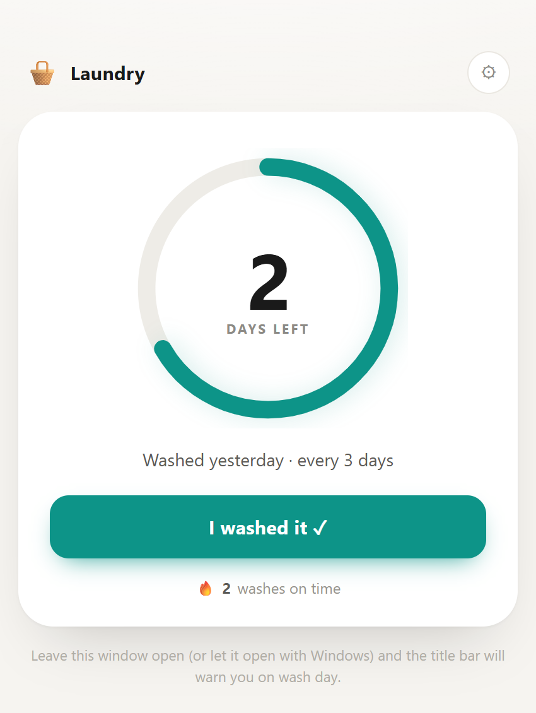

# 🧺 Laundry Reminder

A tiny countdown that tells you when to do your laundry.

One HTML file, no framework, no build step, no dependencies, no network calls. Open it and it works.

**Live demo:** _not deployed yet — see [Deploy to GitHub Pages](#deploy-to-github-pages)._

## Why

I kept putting off laundry until it became a whole afternoon of shame. So I built the smallest possible thing that answers one question: *how many days do I have left?*

It doesn't try to be a task manager. It's a clock with opinions.

## What it does

- **A countdown ring** that drains as your pile gets staler.
- **Color as urgency** — teal when you're fine, amber on wash day, red when you're late.
- **The window title changes** to `🧺 Wash today!`, so it's visible in the taskbar even if the window is buried.
- **A streak** of washes done on time. Breaking it is more motivating than building it.
- **Snooze** for the days you genuinely can't.
- **Configurable** interval (default 3 days) and last-wash date.

## Run it

### Windows — as an app window

Double-click **`laundry-reminder.bat`**. It opens `index.html` in Edge or Chrome app mode: no tabs, no address bar, just the window.

Works on Windows 10/11 out of the box — Edge ships with the OS. Chrome is used as a fallback; if neither is found, the default browser opens instead.

**Start it with Windows** (optional):

1. `Win + R` → `shell:startup` → Enter
2. Right-click → **New** → **Shortcut**
3. Paste the full path to `laundry-reminder.bat`, click Finish

### macOS / Linux — or any browser

Just open `index.html`. You lose app-window mode but everything else works.

> **Note on saving:** state lives in `localStorage`, which browsers treat loosely for `file://` pages. If the app can't save, it says so in small text at the bottom rather than silently forgetting. Hosting it (below) avoids this entirely.

## Deploy to GitHub Pages

1. Push this repo to GitHub.
2. **Settings → Pages → Build and deployment → Deploy from a branch → `main` / `root`.**
3. Your app is live at `https://<your-username>.github.io/<repo-name>/`.
4. Replace the *Live demo* line at the top with that URL.

Served over `https://`, storage is a normal, well-defined origin — the persistence caveat above disappears.

## Files

| File | Purpose |
|---|---|
| `index.html` | The entire app — markup, styles, logic |
| `laundry-reminder.bat` | Windows launcher (app-window mode) |
| `screenshot.png` | README image |

## Limitations

Honest list, because overclaiming is worse than scope:

- **It doesn't interrupt you.** There's no toast or sound. You have to see the window or the taskbar title.
- **No undo.** Clicking "I washed it" is immediate; a misclick can only be repaired by resetting the streak in settings.
- **State is per browser profile.** Open it in Edge one day and Chrome the next, and you get two separate streaks.
- **One laundry load, one interval.** Whites, darks and bedding have to share a schedule.
- **The Windows launcher is Windows-only.** Everything else is portable.

## License

MIT — see [LICENSE](LICENSE).
